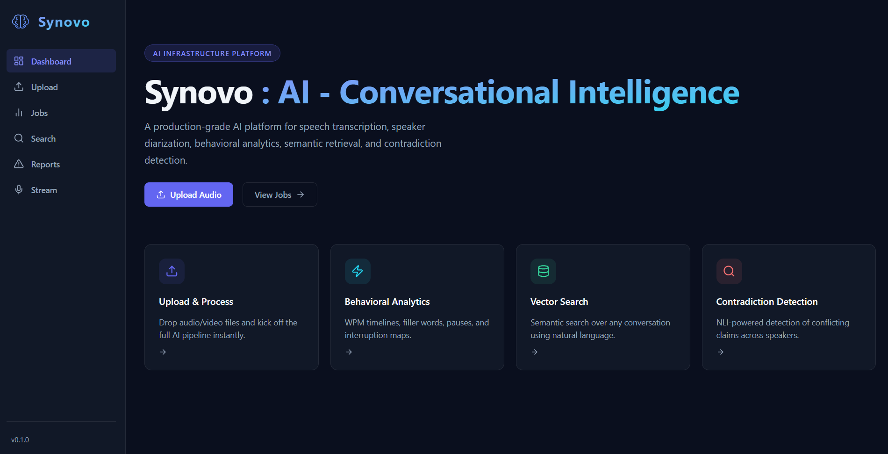

# Synovo



Synovo is an AI-powered conversational intelligence platform for speech transcription, speaker-aware analysis, semantic search, behavioral analytics, contradiction detection, and real-time conversation insights.

The project combines a FastAPI backend, Celery AI workers, Postgres, Redis, Qdrant, and a Next.js dashboard to process uploaded or live audio and turn it into searchable transcripts, analytics, topic maps, and executive reports.

## Features

- Audio and video upload for asynchronous conversation processing.
- Real-time speech streaming through WebSockets.
- Faster Whisper transcription.
- Speaker diarization with Pyannote.
- Semantic embeddings and vector search with Qdrant.
- Topic clustering and topic-map visualization.
- Contradiction detection across transcript chunks.
- Conversation analytics such as words per minute and behavioral signals.
- AI-generated executive reports with PDF download support.
- Celery worker queues for transcription, diarization, embedding, analytics, topic modeling, and contradiction detection.

## Tech Stack

| Area           | Technology                                                              |
| -------------- | ----------------------------------------------------------------------- |
| Backend        | FastAPI, Pydantic, SQLAlchemy, Alembic                                  |
| Frontend       | Next.js 14, React, TypeScript, Tailwind CSS                             |
| Workers        | Celery, Redis                                                           |
| Database       | Postgres                                                                |
| Vector Search  | Qdrant                                                                  |
| AI Models      | Faster Whisper, Pyannote, Sentence Transformers, Transformers, BERTopic |
| Infrastructure | Docker Compose                                                          |

## Repository Structure

```text
backend/
  ai/                 AI engines for transcription, diarization, embeddings, analytics, topics, and contradictions
  app/                FastAPI app, API routes, database models, schemas, services, and config
  tests/              Backend test suite
  workers/            Celery app, worker pipeline, task definitions, and worker status helpers

frontend/
  app/                Next.js application routes and dashboard pages
  components/         Shared UI components
  lib/                Frontend API client helpers

infra/                Infrastructure-related files
docs/                 Project documentation
docker-compose.yml    Local backend, worker, database, cache, and vector DB stack
```

## Prerequisites

- Docker and Docker Compose.
- Node.js 18 or newer.
- Python 3.11 or newer if running backend tools outside Docker.
- A Hugging Face token if you want to use Pyannote diarization.

The first full run may download several gigabytes of Docker images and AI model weights. Use a stable internet connection and make sure enough disk space is available.

## Environment Setup

Create a backend environment file:

```bash
cp backend/.env.example backend/.env
```

If there is no example file, create `backend/.env` manually and set the values you need. The application has defaults for local Docker development, but diarization requires a Hugging Face token:

```env
HUGGINGFACE_TOKEN=your_huggingface_token
WHISPER_MODEL_SIZE=large-v3
WHISPER_DEVICE=cpu
WHISPER_COMPUTE_TYPE=int8
ENABLE_CPU_DIARIZATION=true
```

For GPU hosts, update the Whisper device and compute type as appropriate:

```env
WHISPER_DEVICE=cuda
WHISPER_COMPUTE_TYPE=float16
```

## Running Locally

Start the backend, databases, cache, vector store, Celery workers, Celery Beat, and Flower:

```bash
docker-compose up -d --build
```

This starts:

- FastAPI backend: `http://localhost:8000`
- Postgres: `localhost:5432`
- Redis: `localhost:6379`
- Qdrant: `http://localhost:6333`
- Flower Celery dashboard: `http://localhost:5555`
- Celery workers for transcription, diarization, and intelligence tasks.

Start the frontend in a separate terminal:

```bash
cd frontend
npm install
npm run dev
```

Open the dashboard:

```text
http://localhost:3000
```

## End-to-End Testing

Use this flow to test the platform with real audio:

1. Start the backend and AI infrastructure with `docker-compose up -d --build`.
2. Start the frontend with `npm run dev` from the `frontend` directory.
3. Open `http://localhost:3000`.
4. Go to the Upload page.
5. Upload a small `.mp3`, `.wav`, or `.mp4` file containing speech.
6. Go to the Jobs page and wait for the job to complete.
7. Open the completed job to review transcripts, topic clusters, contradiction results, WPM analytics, and report generation.

To test live streaming:

1. Open the Stream page from the dashboard sidebar.
2. Start the microphone stream.
3. Speak into the microphone and confirm that live transcription updates through WebSockets.

## Running Tests

Backend tests are written with Pytest.

Run them from the backend directory:

```bash
cd backend
pytest
```

Run a specific test file:

```bash
pytest tests/test_upload.py
```

Run the diarization tests:

```bash
pytest tests/test_diarization.py
```

Frontend checks can be run from the frontend directory:

```bash
cd frontend
npm run lint
npm run build
```

## Useful Commands

Check running containers:

```bash
docker ps
```

View logs for all services:

```bash
docker-compose logs
```

View logs for one service:

```bash
docker-compose logs api
docker-compose logs worker-transcription
docker-compose logs worker-diarization
docker-compose logs worker-intelligence
```

Stop local infrastructure:

```bash
docker-compose down
```

Stop local infrastructure and remove volumes:

```bash
docker-compose down -v
```

## API and Dashboard

- Dashboard: `http://localhost:3000`
- Backend API: `http://localhost:8000`
- API docs: `http://localhost:8000/docs`
- Qdrant: `http://localhost:6333`
- Flower: `http://localhost:5555`

Flower uses the local credentials configured in `docker-compose.yml`:

```text
username: admin
password: admin
```

## Notes

- AI model weights, virtual environments, local databases, Docker volumes, generated caches, and local implementation notes are intentionally ignored by Git.
- Keep `backend/app/models/` tracked. It contains application database model code, not downloaded AI model artifacts.
- Large model caches should live in `/models/`, `/backend/models/`, or another explicitly ignored cache directory.
- CPU diarization can be memory-heavy. For faster processing, use a GPU-capable host where possible.

## License

This project is licensed under the MIT License. See [LICENSE](LICENSE) for details.
